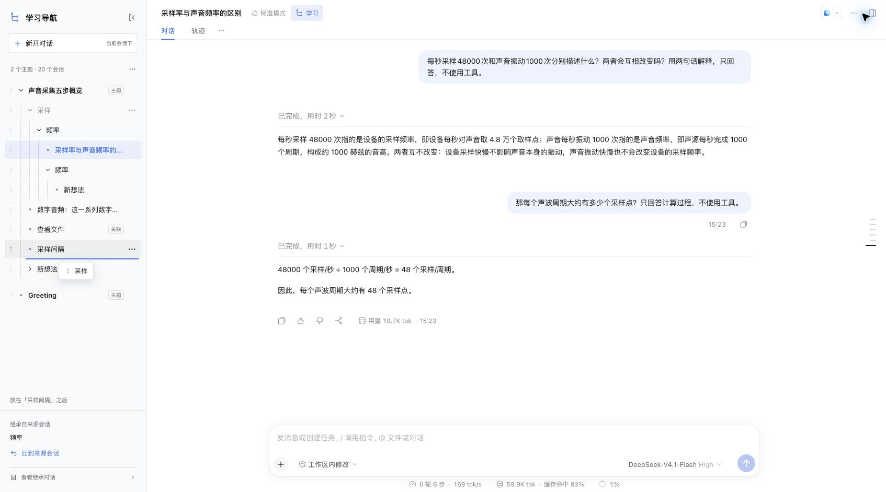

# DSH Study Tree

[中文](README.md) · [Architecture, in Chinese](ARCHITECTURE.md) · [Releases](https://github.com/duroey/dsh-study-tree/releases) · [Compatibility CI](https://github.com/duroey/dsh-study-tree/actions/workflows/compatibility.yml)

Follow a side question without losing the main conversation. Select text in a completed DSH answer, fork a real session with its context, and keep learning in native Agent chat.

**One tree node is one persistent DSH session. Chat is the workspace; the tree is navigation.**

Independent community plugin for DeepSeek Harness. Not affiliated with DeepSeek.

## Features

- Fork from selected text, inheriting history through the answer's completed turn.
- Continue normal chat in a branch and recursively fork deeper branches.
- Switch sessions and return to the original passage or source session.
- Start a side question without selecting text. An unsent draft creates no native session and disappears on cancel, navigation, or reload.
- Name a new no-selection branch from its first local question using the host's title model. Native and tree titles stay synchronized; failures retain the temporary title.
- Drag an entire row to reorder branches **within the same parent**. Descendants travel with their branch.
- Collapse the learning drawer to return to the native session list.

The learning controls currently use Chinese; Plugin Manager metadata is supplied in English and Chinese.

## Install

Requires DeepSeek Harness Web. Node.js 24 is recommended. Set up the host using the [official instructions](https://github.com/deepseek-ai/deepseek-harness#run).

Install the prebuilt release:

~~~sh
dsh plugin --profile web add https://github.com/duroey/dsh-study-tree/releases/download/v0.1.6/dsh-study-tree-0.1.6.tgz
dsh web
~~~

Or install from Git:

~~~sh
dsh plugin --profile web add github:duroey/dsh-study-tree#v0.1.6
~~~

Built files are committed and included in the archive; users do not need a separate plugin build. Replace `web` if using another profile. Restart DSH and refresh the page after replacing a loaded version.

## Use

Open a native session, choose **学习** (Study), and start a topic from that session. Select text in a completed answer and choose **深入了解** (Explore further). Continue in the resulting native session, or select text again to create another branch.

**新开对话** (New conversation) starts a temporary side-question draft under the current session. Its first send creates the fork. **回到原文** (Return to passage) and **回到来源会话** (Return to source) follow the recorded fork origin.

Selected-text branches use the chosen name or quotation. No-selection branches receive an automatic title after the first send. Title generation uses the configured DSH model and may incur an additional auxiliary call.

## Context and data

Reordering navigation never rewrites inherited context. A future fork inherits the **real session it is forked from**, regardless of where that session appears in the index. Attaching an existing session or explicitly changing its navigation parent is an index operation, not context inheritance. Dragging itself cannot change parents.

The host stores the index, quotations, surrounding text and origins at `$DSH_HOME/community/dsh-study-tree/tree.json`, defaulting to `~/.dsh`. Profiles sharing that home share this index. Native conversations remain owned by DSH.

Browser-local state includes reading positions and recovery receipts, which may contain a submitted question. Unsent drafts are memory-only. Revision checks and file locks protect tree writes. Recovery reuses a known child ID where possible; uncertain prompt delivery is never automatically retried.

Remove with `dsh plugin --profile web remove dsh-study-tree`. Removing the plugin or an index branch does not delete native sessions; index data remains on disk.

## Compatibility and development

On 2026-11-08, npm `latest` was `0.2.2-rc.1`. Existing manual acceptance covers recursive learning flows on `0.2.2-rc.1` and `0.1.1-rc.2`, and selected-text fork plus chat on `0.2.1-rc.5`. Version 0.1.6 specifically rechecked sibling dragging on the newest and oldest baselines. The legacy test fixture repairs upstream dependency drift.

The declared range `>=0.1.1-rc.2 <1.0.0` is an installation policy, not a promise that every release has been tested. Scheduled CI checks installation and contracts against fixed versions and `latest`; it does not exercise the full UI. DOM anchoring and the host's title helper remain adaptation points. See [the verification summary](verification.json) and [architecture](ARCHITECTURE.md).

~~~sh
npm ci
npm run verify
npm pack
~~~

Verification runs typechecking, 75 tests using Node's built-in runner, and Host/Client builds. Build outputs in `lib/` must be regenerated with source changes.

The package follows the official [bundle format](https://github.com/deepseek-ai/deepseek-harness/blob/master/docs/user/develop/basic/publish.md), exports localized metadata and an original icon, and uses the [`dsh-plugin` discovery topic](https://github.com/deepseek-ai/deepseek-harness/blob/master/CONTRIBUTING.md). Publication does not imply official endorsement or third-party index inclusion.

## License

MIT. Text selection and source anchoring adapt [DSH Inline Study](https://github.com/Chen-chy/dsh-inline-study); its license is retained in [THIRD_PARTY_NOTICES](THIRD_PARTY_NOTICES).
