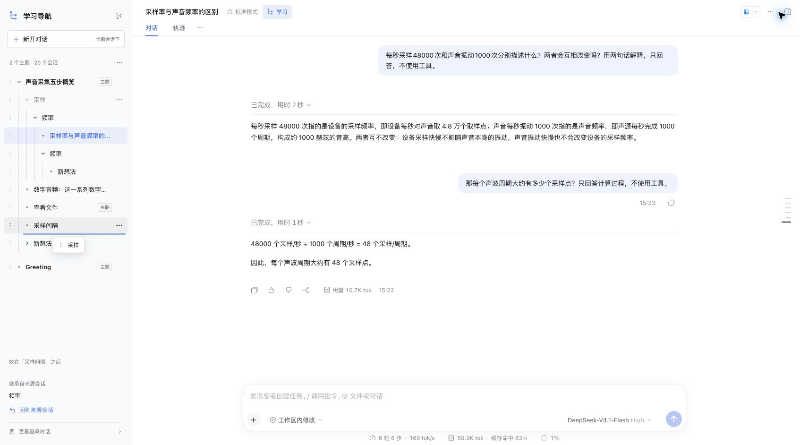

# DSH Study Tree · 学习导航

[English](https://github.com/duroey/dsh-study-tree/blob/main/README.en.md) · [架构说明](https://github.com/duroey/dsh-study-tree/blob/main/ARCHITECTURE.md) · [下载 v0.1.6](https://github.com/duroey/dsh-study-tree/releases/tag/v0.1.6) · [兼容检查](https://github.com/duroey/dsh-study-tree/actions/workflows/compatibility.yml)

学习一个概念时，常常要先弄懂里面的另一个概念。DSH Study Tree 让你从回答中划词，派生一个继承上下文的新会话，再从新会话继续深入。父会话保留原来的讨论和阅读位置，树状导航负责把这些会话组织起来。

**一个节点就是一个真实的 DSH session。聊天是主要工作区，树只是导航。**

这是独立的 DeepSeek Harness 社区插件，不隶属于 DeepSeek。

## 能做什么

- **划词 fork**：在一段已完成的回答中选中文字，用一个新问题创建分支，继承到该回答所属已完成轮次为止的上下文。
- **递归深入**：在子会话里正常聊天，也可以再次划词，创建下一层学习分支。
- **返回主线**：切换树节点，回到原会话；“回到原文”尝试定位当初展开的段落。
- **新开对话**：不必先划词，也能从当前会话提出一个新问题。首次发送前只是临时草稿，取消、离开或刷新都会丢弃它。
- **自动命名**：通过“新开对话”创建的分支，在首条问题发送后生成标题，和原生会话标题保持一致。
- **同级排序**：整行都能拖动，同一父节点下的分支可以调整顺序，子树一起移动。不同父节点间不能拖动。
- **专注学习**：学习导航覆盖原有会话列表，收起后恢复原列表；对话继续使用 DSH 原生界面。

例如：

~~~text
声音采集
└─ 采样
   └─ 频率
      ├─ 采样率与声音频率的区别
      └─ 一个声波周期有多少个采样点？
~~~

这些是可以持续对话的会话，不是被拆成节点的一问一答。

## 安装

需要 DeepSeek Harness Web。建议使用 **Node.js 24**；安装和配置宿主请参考 [DSH 官方说明](https://github.com/deepseek-ai/deepseek-harness#run)。

推荐从 npm 安装固定版本：

~~~sh
dsh plugin --profile web add dsh-study-tree@0.1.6
dsh web
~~~

也可以使用固定版本的 Git 安装：

~~~sh
dsh plugin --profile web add github:duroey/dsh-study-tree#v0.1.6
~~~

也可以从 [Releases](https://github.com/duroey/dsh-study-tree/releases/tag/v0.1.6) 下载 `dsh-study-tree-0.1.6.tgz`，再安装本地文件：

~~~sh
dsh plugin --profile web add ./dsh-study-tree-0.1.6.tgz
~~~

固定版本 Git 安装、公开附件下载及下载后的本地安装均已验证。若包管理器直接拉取 GitHub 附件遇到网络超时，可以下载后安装本地文件，或改用 npm 和 Git 入口。

仓库和 Release 都包含构建产物，使用者不需要另外构建插件。使用其他 profile 时，将安装命令里的 `web` 换成你的 profile。更新已经加载的版本后，重启 DSH 并刷新页面，确保 Host 与浏览器加载的是同一版。

## 开始使用

1. 打开一个正常会话，点会话顶栏中的“学习”，以当前会话开始学习主题。
2. 在已完成的回答中选中文字，点“深入了解”，填写想继续问的问题。
3. 进入新分支后，直接在正常聊天框里继续问；需要再深入时，再次划词。
4. 用左侧树切换会话；“回到原文”或“回到来源会话”返回真实的分叉来源。
5. 想到一个没法划词的新问题时，点“新开对话”。输入并发送后才会真正创建分支。

划词分支使用你填写的名称或所选引用；“新开对话”的分支使用首条问题自动命名。自动标题沿用 DSH 配置的模型，可能产生一次额外的辅助模型调用；失败时会保留临时标题，对话可以继续。当前学习交互主要使用中文，插件管理器提供中英文名称和说明。

## 导航关系与上下文

**拖动排序不会改变任何会话的上下文。** 从哪个真实会话创建 fork，新分支就继承那个会话的真实历史；导航里的摆放位置不会重新拼装上下文。

一个根会话及其导航后代组成一个学习主题，没有额外的项目系统。

“关联已有会话”收在管理菜单里，只把已有会话加入索引，不产生新的继承关系。管理窗口中的显式“导航位置”调整也只改变索引，不会改写 fork 来源；返回来源始终按保存的来源信息执行。拖拽则限制为同父节点排序，避免无意间改变层级。

## 兼容性

截至 **2026-11-08**，核对到的 npm `latest` 是 **DSH 0.2.2-rc.1**。

| DSH 版本 | 已有实机验证 |
| --- | --- |
| `0.2.2-rc.1` | 递归 fork、多轮聊天、父会话隔离、返回来源、刷新恢复；临时草稿、自动标题、同级拖动 |
| `0.1.1-rc.2` | 同上，使用旧版导航和草稿显示适配；旧版独立测试环境需要依赖版本修复，见架构说明 |
| `0.2.1-rc.5` | 真实划词 fork、原生聊天；未宣称完成上述全部交互验收 |

交互验收来自连续开发阶段；v0.1.6 重点重测了新旧两端的拖动，没有把整套递归 fork 流程重新跑一遍。公开 CI 检查固定版本和滚动的 `latest`，覆盖测试、打包、安装与接口契约；**CI 契约通过不等于真实 UI 全功能验收**。

`engines.dsh` 声明 `>=0.1.1-rc.2 <1.0.0`，它是安装范围，不是对全部历史和未来版本的测试承诺。宿主仍在快速变化，尤其是文字定位的 DOM 约定和自动标题 helper，遇到变化时可能需要适配。具体边界见 [架构说明](https://github.com/duroey/dsh-study-tree/blob/main/ARCHITECTURE.md#兼容适配与已知边界) 和 [验收摘要](https://github.com/duroey/dsh-study-tree/blob/main/verification.json)。

## 数据保存与卸载

- 树文件：`$DSH_HOME/community/dsh-study-tree/tree.json`；未设置 `DSH_HOME` 时使用 `~/.dsh`。同一 `DSH_HOME` 下的 profile 共用这个导航文件。
- 树保存会话 ID、导航父节点、原生标题快照、分叉轮次、选中引用及前后文。完整聊天和 Agent 执行仍由 DSH 管理。
- 阅读位置、面板开关和未完成操作的恢复回执保存在当前浏览器。恢复回执可能包含已提交的问题；**未发送草稿本身只在内存中**。
- 树保存包含修订号检查和文件锁；并发冲突会载入最新树并提示重试。已有子会话的恢复会尽量复用原 ID；发送结果不确定时不会自动重发问题。
- “查看继承对话”只切换显示，不删除历史。原文不存在、没有加载或无法唯一匹配时，会提示定位失败。

卸载插件：

~~~sh
dsh plugin --profile web remove dsh-study-tree
~~~

卸载或移出学习树不会删除原生 DSH 会话。卸载后导航数据仍保留，可先自行备份。

## 开发

~~~sh
git clone https://github.com/duroey/dsh-study-tree.git
cd dsh-study-tree
npm ci
npm run verify
npm pack
~~~

`npm run verify` 执行类型检查、Node 内置测试和双端构建。目前有 **75 个测试**。`lib/` 提交到仓库供 Git 安装使用，修改源码后需要重新构建。

对实际安装的宿主检查接口和组合配置：

~~~sh
DSH_HOME=/path/to/your-dsh-home node scripts/check-host.mjs --runtime /path/to/installed-dsh --profile web
~~~

这里必须使用此前已安装插件的同一 DSH_HOME 和 profile；脚本不会替你安装插件。命令需要使用与宿主匹配的 Node 版本；检查真实安装包，不借用相邻版本的声明。项目代码结构、数据格式、两种 fork 流程、恢复机制、依赖和兼容边界都在 [ARCHITECTURE.md](https://github.com/duroey/dsh-study-tree/blob/main/ARCHITECTURE.md)。

## 社区规范与许可

包使用官方 `dsh.bundle` / `dsh.client` manifest、`cordis.patch.yml`，并提供导出的中英文 metadata 和原创 SVG 图标。GitHub 仓库使用 `dsh-plugin` topic，供社区检索发现。

参考：[官方插件打包指南](https://github.com/deepseek-ai/deepseek-harness/blob/master/docs/user/develop/basic/publish.md)、[官方插件模板与资源说明](https://github.com/deepseek-ai/deepseek-harness/blob/master/packages/preset/agent-preset/skills/cordis-plugin-development/references/host-plugin.md)、[社区贡献说明](https://github.com/deepseek-ai/deepseek-harness/blob/master/CONTRIBUTING.md)。已公开源代码不代表获得任何第三方索引的收录或官方认证。

MIT。选区捕获和原文定位参考并改编自 [DSH Inline Study](https://github.com/Chen-chy/dsh-inline-study)，原许可保留在 [THIRD_PARTY_NOTICES](https://github.com/duroey/dsh-study-tree/blob/main/THIRD_PARTY_NOTICES)。
